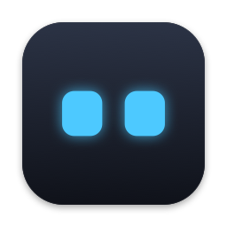
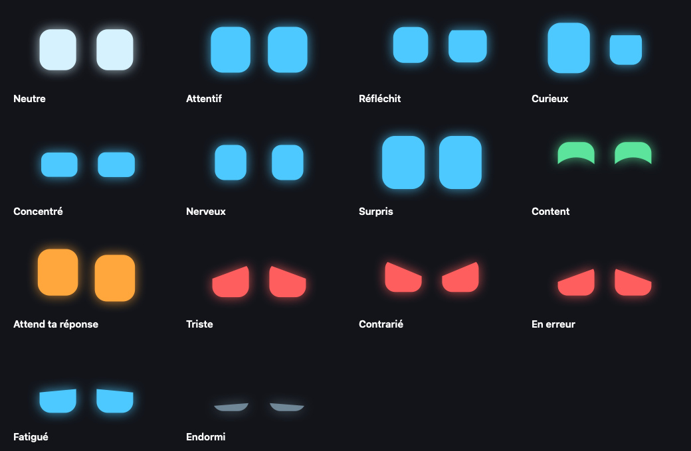
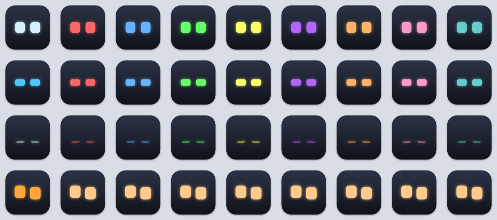
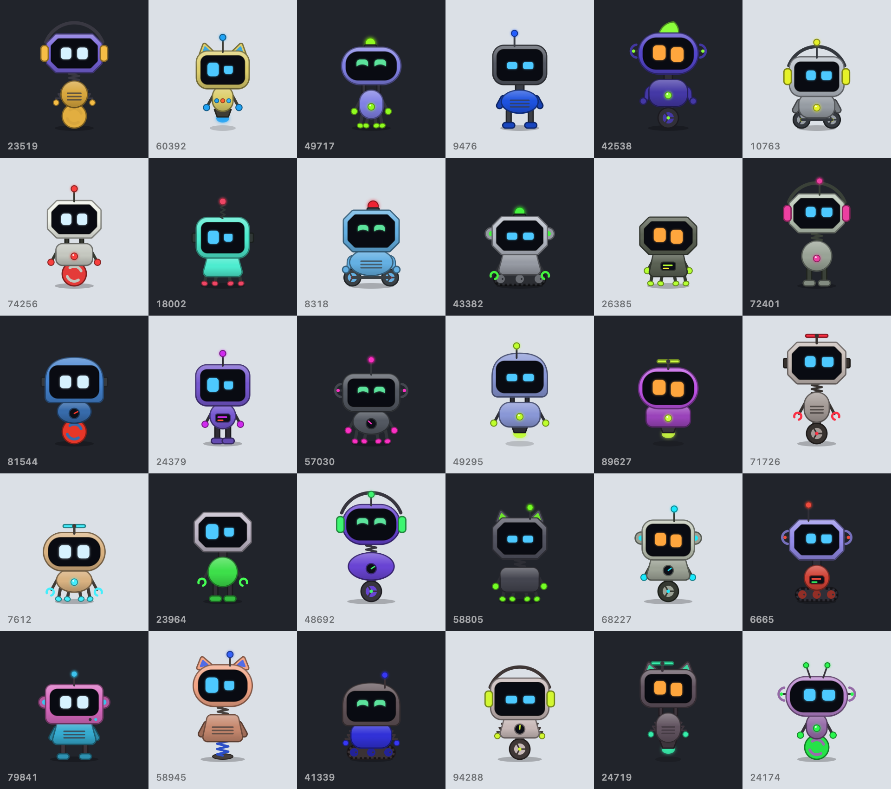

<p align="center">
  
</p>

<h1 align="center">Claude Eyes</h1>

<p align="center">
  Des yeux de robot macOS qui réagissent à chaque session Claude Code.<br>
  <a href="README.md">English</a> · <b>Français</b>
</p>

---

Quand plusieurs sessions Claude Code tournent en même temps, difficile de savoir laquelle réfléchit, laquelle a fini et laquelle t'attend. Claude Eyes donne à chaque session son petit robot, construit au hasard, avec des yeux de robot dans l'esprit de Cozmo, Vector ou Emo : ils se concentrent quand Claude écrit du code, regardent autour d'eux quand il lit, deviennent nerveux pendant les tests, sourient quand il a fini et passent à l'orange quand une session a besoin de toi.



## Fonctionnalités

- **Robots** : un robot par session, tiré d'une graine : chenilles, roues, pattes, ressort ou lévitation, forme de tête, antennes, oreilles, bras, couleurs… aucun n'est pareil. Ils se baladent en bas de chaque écran, montent sur les fenêtres qui ont de la place au-dessus (en roulant le long du bord, en volant, en rebondissant, à la force des bras ou au grappin, selon leurs pièces) et marchent dessus, passent d'un écran à l'autre et s'endorment avec leur session. Ils se rencontrent aussi : ils se saluent, se rendent visite, jouent à chat, font la fête quand une session se termine, et trouvent endormi un robot qui dort. Pendant que Claude travaille, son robot tient l'outil du moment (une loupe pour lire, un clavier pour écrire du code, une clé pour une commande, une éprouvette qui fume pendant les tests), lance des confettis quand les tests passent et fait des étincelles sur une erreur ; chaque sous-agent court autour de lui en petit modèle. Les sessions d'un même dépôt portent le même fanion (une couleur et l'initiale du dépôt), restent ensemble, se suivent à la file et se tapent dans la main quand elles se croisent. Les robots s'assoient au bord des fenêtres les jambes dans le vide, suivent ta souris des yeux, aiment les caresses (passe doucement la souris sur eux), ont le tournis quand tu les secoues et s'habillent selon la saison (citrouille, bonnet de Noël, bonnet) avec une lampe frontale la nuit. Quand une session t'attend, son robot toque à la fenêtre de son terminal si elle est sur ton écran, sinon il vient près de ta souris et sautille. Un clic sur un robot ouvre le terminal de sa session, un glisser le déplace (il retombe là où tu le lâches), un clic droit ouvre son menu (son, nouveau robot). Survole-le pour voir sa session et ce que fait Claude ; cette bulle s'affiche aussi quelques secondes quand la session change d'état.
- **Dock** : soit une icône animée qui montre la session la plus importante (la pastille compte les sessions qui t'attendent), soit **une icône par session**, au nom de la session.
- **Barre des menus** : une icône fixe qui liste les sessions, affiche ou rappelle les robots, ouvre le labo des robots (des robots au hasard qui enchaînent tous leurs mouvements : choix de l'étape, de l'humeur ou de la couleur des yeux, on les attrape, les lance, les secoue, les caresse ou clique dessus) et les réglages.
- **Tes noms et tes couleurs** : le titre donné avec `/rename` et la couleur choisie avec `/color` dans Claude Code sont repris automatiquement. Les états calmes prennent la couleur de la session, les alertes gardent la leur (orange pour l'attente, rouge pour une erreur, vert quand c'est fini) et clignotent pour ne jamais passer inaperçues.
- **Sons** : un petit bip de robot quand une session commence à t'attendre ou termine sa réponse (un son triste en cas d'erreur). Tous les sons se coupent depuis la barre des menus (Couper le son), celui de chaque session depuis la barre des menus, un clic droit sur son robot ou son icône du Dock.
- **Toutes les sessions** : chaque session est signalée par un hook de Claude Code. Celles qui tournent sans avoir encore déclenché de hook sont repérées dans la liste des processus et affichées endormies.
- **Compatible avec ton terminal** : un clic sur un robot ramène exactement l'onglet de la session dans Ghostty, Terminal, iTerm2 et WezTerm, et met au premier plan n'importe quelle autre app de terminal. Dans Ghostty et iTerm2, la barre de progression de l'onglet suit l'état de Claude : elle ne disparaît plus pendant les longues réflexions, et reste orange tant qu'une session attend ta réponse.
- **Léger** : robots et visages dessinés par la carte graphique, marches animées par le serveur graphique, position des fenêtres lue seulement quand un robot est perché : environ 2 à 3 % de CPU pour l'app avec trois robots, et 0,5 à 2 % par icône du Dock.





*Quelques robots sortis du générateur.*

*Les états calmes prennent la couleur `/color` de la session. La dernière ligne montre une session qui t'attend : elle reste orange et clignote.*

## Fonctionnement

```
Claude Code ── événement ──▶ hooks/claude-state.sh ──▶ ~/.claude/eyes/sessions/<session>.json ──▶ Claude Eyes.app
                                      │
                                      └──▶ barre de progression de l'onglet dans Ghostty et iTerm2 (OSC 9;4)
```

Claude Code lance le hook à chaque événement (message envoyé, outil lancé ou terminé, permission demandée, réponse terminée…). Le hook écrit l'état de la session dans un petit fichier JSON, et l'app surveille ce dossier. Elle traduit l'état, l'outil utilisé et ce que révèle sa sortie (tests en échec, erreurs, grosses modifications) en expression. Le statut en direct de Claude Code lui indique quand une fenêtre de dialogue t'attend et quand tu y as répondu, même si des sous-agents continuent de travailler.

| Expression | Quand |
|---|---|
| Neutre | Session ouverte, rien en cours |
| Attentif | Tu viens d'envoyer un message |
| Réfléchit | Aucun événement depuis quelques secondes |
| Curieux | Lit des fichiers, cherche dans le code ou sur le web |
| Concentré | Écrit du code, lance une commande ou un agent |
| Nerveux | Lance les tests, le linter ou la vérification des types |
| Surpris | Vient d'écrire une grosse modification |
| Content | Réponse terminée, ou tests réussis |
| Attend ta réponse | Demande de permission, question ou plan à valider |
| Triste | Un outil a échoué, ou des tests sont rouges |
| Contrarié | Le mode auto a refusé une action |
| En erreur | La réponse s'est arrêtée sur une erreur d'API |
| Fatigué | Compacte la conversation |
| Endormi | Aucune activité depuis un moment |

## Prérequis

- macOS 14 ou plus récent, sur Apple Silicon
- [`jq`](https://jqlang.org) (`brew install jq`), utilisé par le hook
- Claude Code 2.1 ou plus récent
- N'importe quel terminal : voir [Terminaux pris en charge](#terminaux-pris-en-charge) pour ce que chacun apporte
- Pour compiler depuis les sources : Xcode ou les Command Line Tools (`swiftc`, `iconutil`, `codesign`)

## Installation

### Depuis une release

1. Télécharge `ClaudeEyes-<version>.zip` depuis la [dernière release](https://github.com/AnselmeSDR/ClaudeEyes/releases/latest), décompresse-le et range **Claude Eyes** dans ton dossier Applications.
2. Ouvre-la. L'app n'est pas notarisée : macOS bloque son premier lancement. Clique sur **Ouvrir quand même** dans **Réglages Système → Confidentialité et sécurité** (ou lance une fois `xattr -dr com.apple.quarantine "/Applications/Claude Eyes.app"`).
3. L'app propose d'installer son hook Claude Code : elle le copie dans `~/.claude/hooks/claude-state.sh` et l'enregistre dans `~/.claude/settings.json`. **Réglages → Claude Code** le fait aussi.

Mises à jour : une fois par jour, l'app cherche une nouvelle release sur GitHub et la propose (barre des menus, menu du Dock ou **Réglages → Mises à jour**, où la vérification quotidienne se désactive ; c'est le seul accès réseau de l'app). Elle télécharge le zip, vérifie son SHA-256 et sa signature, se remplace et se relance ; le hook est mis à jour avec elle.

### Depuis les sources

```bash
git clone https://github.com/AnselmeSDR/ClaudeEyes.git
cd ClaudeEyes
./build.sh --install     # compile « Claude Eyes.app », la copie dans ~/Applications et la lance
hooks/install.sh         # crée le lien vers le hook et l'enregistre dans ~/.claude/settings.json
```

Mise à jour avec `git pull` puis `./build.sh --install` : l'app ne touche pas à un hook installé par lien.

### Le hook

Dans les deux cas, tes réglages sont sauvegardés dans `~/.claude/settings.json.bak-claude-eyes`, le hook est enregistré sur tous les événements qu'il traite et la barre de progression propre à Claude Code est désactivée (`terminalProgressBarEnabled: false`), le hook la remplaçant dans Ghostty et iTerm2. Désactiver la barre du hook dans les réglages rend sa barre à Claude Code. Les sessions lancées avant l'installation du hook n'apparaissent qu'une fois relancées.

Les sessions déjà ouvertes apparaissent tout de suite et se réveillent à leur prochain événement. Au premier clic sur un visage, macOS demande l'autorisation de contrôler ton app de terminal.

Pour lancer l'app à l'ouverture de session, ouvre les **Réglages** depuis l'icône de la barre des menus et active **Lancer à l'ouverture de session**.

## Terminaux pris en charge

| Terminal | Clic sur un visage | Barre de progression de l'onglet |
|---|---|---|
| [Ghostty](https://ghostty.org) | Onglet ou split exact | Oui, à partir de la 1.2 |
| iTerm2 | Onglet exact | Oui, à partir de la 3.6.6 |
| Terminal | Onglet exact | Non |
| WezTerm | Panneau exact | Non |
| VS Code, Cursor, Warp, kitty, autres | L'app passe au premier plan | Non |

Le terminal de chaque session est détecté automatiquement, à partir de la chaîne des processus. Pour une session lancée dans tmux, le clic ramène l'app de terminal depuis laquelle elle a été démarrée. La barre de progression n'est envoyée qu'aux terminaux pour lesquels Claude Code l'active lui-même : ailleurs, la même séquence peut s'afficher comme une notification. Elle se désactive dans **Réglages → Terminal**, et la barre de Claude Code reprend alors sa place. Dans Ghostty, `progress-style = false` masque toutes les barres, quelle que soit l'app.

## Réglages

Ils s'ouvrent depuis l'icône de la barre des menus (**Réglages…**) :

- **Robots** : affichage, escalade des fenêtres, masquage sans session, rappel sur l'écran actuel, labo des robots.
- **Dock** : icône animée ou non, une seule icône pour la session la plus importante ou une icône par session.
- **Comportement** : durée de l'air content après une réponse, délai avant de s'endormir.
- **Sons** : quand une session t'attend, quand elle a fini, quand elle s'arrête sur une erreur, volume.
- **Claude Code** : hook installé et à jour ou non, installation ou réinstallation.
- **Terminal** : les terminaux détectés pour tes sessions, barre de progression de l'onglet activée ou non.
- **Système** : lancement à l'ouverture de session.
- **Mises à jour** : version installée, vérification quotidienne activée ou non, vérification immédiate.
- **Expressions** : une galerie animée de toutes les expressions, avec ce qui les déclenche.

## Fichiers

| Emplacement | Contenu |
|---|---|
| `~/.claude/eyes/sessions/` | Un fichier JSON par session, écrit par le hook |
| `~/.claude/sessions/<pid>.json` | Registre de Claude Code, lu pour les titres `/rename` et pour savoir si la session t'attend |
| `~/.claude/projects/…/<session>.jsonl` | Transcriptions, lues au fil de l'eau pour `/color` |
| `~/Library/Application Support/Claude Eyes/Docks/` | Copies de l'app utilisées pour les icônes par session |
| `com.anselme.claude-eyes` | Préférences (`defaults read com.anselme.claude-eyes`) |

## Développement

```bash
./build.sh                                   # compile dans build/
./build.sh --install                         # compile, installe et relance
./build.sh --zip                             # produit aussi build/ClaudeEyes-<version>.zip et son .sha256 (fichiers de release)
"build/Claude Eyes.app/Contents/MacOS/ClaudeEyes" --render-gallery build/gallery.png      # toutes les expressions
"build/Claude Eyes.app/Contents/MacOS/ClaudeEyes" --render-color-tiles build/colors.png   # toutes les couleurs /color
"build/Claude Eyes.app/Contents/MacOS/ClaudeEyes" --render-sounds build/sounds           # tous les sons, en WAV
"build/Claude Eyes.app/Contents/MacOS/ClaudeEyes" --render-robots build/robots.png         # 30 robots au hasard
"build/Claude Eyes.app/Contents/MacOS/ClaudeEyes" --robot-lab [grimpe]                    # robots animés, seuls (première étape au choix)
```

Du Swift compilé avec `swiftc` (AppKit, SwiftUI, Core Animation), sans projet Xcode. L'architecture est décrite dans [CLAUDE.md](CLAUDE.md).

## Désinstallation

```bash
pkill -x ClaudeEyes
rm -rf ~/Applications/"Claude Eyes.app" /Applications/"Claude Eyes.app" ~/Library/Application\ Support/Claude\ Eyes ~/.claude/eyes
rm ~/.claude/hooks/claude-state.sh
defaults delete com.anselme.claude-eyes
```

Retire ensuite les entrées `claude-state.sh` de la section `hooks` de `~/.claude/settings.json` (ou restaure `settings.json.bak-claude-eyes`), ainsi que la ligne `terminalProgressBarEnabled` si tu veux retrouver la barre de progression de Claude Code (désactiver la barre dans les réglages avant de désinstaller le fait pour toi).

## Licence

[AGPL-3.0](LICENSE) © 2026 Anselme SDR — libre d'utiliser, de modifier et de partager ; toute version modifiée, distribuée ou proposée en ligne doit rester open source sous la même licence. Une licence commerciale est disponible pour un usage en code fermé : anselme8@icloud.com.

Claude Eyes est un projet indépendant, sans lien avec Anthropic, Digital Dream Labs ou Living AI, ni approuvé ou soutenu par eux. Claude et Claude Code sont des marques d'Anthropic, Cozmo et Vector de Digital Dream Labs, Emo de Living AI.
