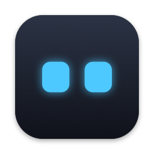
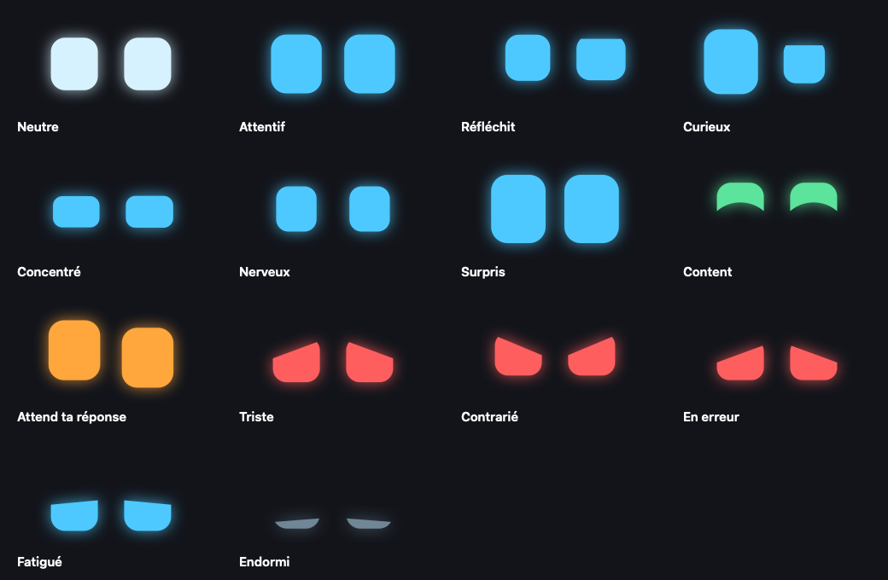
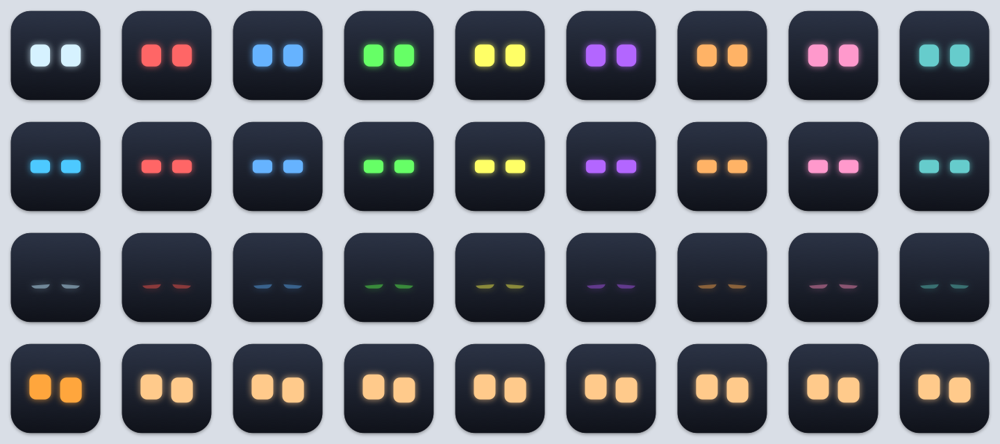

<p align="center">
  
</p>

<h1 align="center">Claude Eyes</h1>

<p align="center">
  macOS robot eyes reacting to every Claude Code session.<br>
  <b>English</b> · <a href="README.fr.md">Français</a>
</p>

---

When you run several Claude Code sessions at once, it is hard to tell which one is thinking, which one is done and which one is waiting for you. Claude Eyes gives each session a pair of robot eyes, in the spirit of Cozmo, Vector or Emo: they focus while Claude writes code, look around while it reads, get nervous during tests, smile when the turn is over and turn orange when a session needs you.



## Features

- **Floating eyes**: a borderless transparent panel with one face per session, the session title and what Claude is doing underneath. Drag it anywhere, click a face to jump to its terminal. Optional frosted glass background.
- **Dock**: either one animated icon showing the session that matters most (badge = sessions waiting for you), or **one Dock icon per session**, named after the session.
- **Menu bar**: a static icon listing every session, the floating panel toggle and the settings.
- **Your names and colors**: the title set with `/rename` and the color set with `/color` in Claude Code are picked up automatically. Calm moods use the session color, alerts keep theirs (orange waiting, red error, green done) and pulse so you never miss them.
- **Sounds**: a short robot chirp when a session starts waiting for you or finishes its turn (a sad one on an error). Mute any session from the menu bar, a right-click on its eyes or its Dock icon.
- **Every session found**: sessions are reported by a Claude Code hook; running sessions that have not triggered any hook yet are found in the process table and shown asleep.
- **Works with your terminal**: clicking a face brings back the exact tab of that session in Ghostty, Terminal, iTerm2 and WezTerm, and brings any other terminal app to the front. In Ghostty and iTerm2, the tab's progress bar follows Claude's state: it no longer disappears during long thinking, and stays orange as long as a session waits for your answer.
- **Light**: GPU-rendered faces, about 1% CPU for the app and 0.5 to 2% per Dock icon.



*Calm moods take the `/color` of the session; the last row is a session waiting for you: it stays orange and pulses.*

## How it works

```
Claude Code ── hook event ──▶ hooks/claude-state.sh ──▶ ~/.claude/eyes/sessions/<session>.json ──▶ Claude Eyes.app
                                       │
                                       └──▶ tab progress bar in Ghostty and iTerm2 (OSC 9;4)
```

Claude Code runs the hook on every event (prompt sent, tool started or finished, permission asked, turn ended…). The hook writes the state of the session to a small JSON file, and the app watches that folder. It turns the state, the tool in use and what the tool output revealed (failed tests, errors, large edits) into an expression. Claude Code's own live status tells when a dialog waits for you and when you answered it, even while subagents keep working.

| Expression | When |
|---|---|
| Neutral | Session open, nothing going on |
| Attentive | You just sent a message |
| Thinking | No event for a few seconds |
| Curious | Reading files, searching the code or the web |
| Focused | Writing code, running a command or an agent |
| Nervous | Running tests, linters or type checks |
| Surprised | Just wrote a large edit |
| Happy | Turn finished, or tests passed |
| Waiting for you | Permission prompt, question or plan to validate |
| Sad | A tool failed, or tests are red |
| Annoyed | Auto mode denied an action |
| Failed | The turn ended on an API error |
| Tired | Compacting the conversation |
| Asleep | No activity for a while |

## Requirements

- macOS 14 or later, Apple Silicon
- Xcode or the Command Line Tools (`swiftc`, `iconutil`, `codesign`)
- [`jq`](https://jqlang.org) (`brew install jq`)
- Claude Code 2.1 or later
- Any terminal; see [Terminal support](#terminal-support) for what each one adds

## Install

```bash
git clone https://github.com/AnselmeSDR/ClaudeEyes.git
cd ClaudeEyes
./build.sh --install     # builds "Claude Eyes.app", copies it to ~/Applications and launches it
hooks/install.sh         # links the hook and registers it in ~/.claude/settings.json
```

`hooks/install.sh` backs up your settings to `~/.claude/settings.json.bak-claude-eyes`, links `~/.claude/hooks/claude-state.sh` to the repository copy and turns off Claude Code's own terminal progress bar (`terminalProgressBarEnabled: false`), which the hook replaces in Ghostty and iTerm2.

Running sessions show up right away; they wake up at their next event. The first click on a face asks for permission to control your terminal app.

To start the app at login, open **Settings** from the menu bar icon and enable **Lancer à l'ouverture de session**.

## Terminal support

| Terminal | Click on a face | Tab progress bar |
|---|---|---|
| [Ghostty](https://ghostty.org) | Exact tab or split | Yes, 1.2 or later |
| iTerm2 | Exact tab | Yes, 3.6.6 or later |
| Terminal | Exact tab | No |
| WezTerm | Exact pane | No |
| VS Code, Cursor, Warp, kitty, others | The app comes to the front | No |

The terminal of each session is detected automatically, from its process tree; sessions inside tmux bring back the terminal app they were started from. The progress bar is only sent to the terminals where Claude Code itself enables it: elsewhere the same escape sequence can show up as a notification. Turn it off in **Settings → Terminal**; in Ghostty, `progress-style = false` hides every progress bar, whatever the app.

## Settings

Open them from the menu bar icon (**Réglages…**):

- **Floating panel**: show or hide, click-through, size, labels, hide when no session, frosted background and its darkness, reset position.
- **Dock**: animated icon on or off, one icon for the most important session or one icon per session.
- **Behavior**: how long the happy face stays after a turn, after how long a session falls asleep.
- **Sounds**: when a session waits for you, when it is done, when it stops on an error, volume.
- **Terminal**: the terminals detected for your sessions, tab progress bar on or off.
- **System**: launch at login.
- **Expressions**: a live gallery of every expression and what triggers it.

## Files

| Path | Content |
|---|---|
| `~/.claude/eyes/sessions/` | One JSON file per session, written by the hook |
| `~/.claude/sessions/<pid>.json` | Claude Code's own registry, read for `/rename` titles and to know when a session waits for you |
| `~/.claude/projects/…/<session>.jsonl` | Transcripts, read incrementally for `/color` |
| `~/Library/Application Support/Claude Eyes/Docks/` | Copies of the app used for per-session Dock icons |
| `com.anselme.claude-eyes` | Preferences (`defaults read com.anselme.claude-eyes`) |

## Development

```bash
./build.sh                                   # build into build/
./build.sh --install                         # build, install and relaunch
"build/Claude Eyes.app/Contents/MacOS/ClaudeEyes" --render-gallery build/gallery.png      # every expression
"build/Claude Eyes.app/Contents/MacOS/ClaudeEyes" --render-color-tiles build/colors.png   # every /color
"build/Claude Eyes.app/Contents/MacOS/ClaudeEyes" --render-sounds build/sounds           # every sound, as WAV
```

Plain Swift compiled with `swiftc` (AppKit, SwiftUI, Core Animation), no Xcode project. See [CLAUDE.md](CLAUDE.md) for the architecture.

## Uninstall

```bash
pkill -x ClaudeEyes
rm -rf ~/Applications/"Claude Eyes.app" ~/Library/Application\ Support/Claude\ Eyes ~/.claude/eyes
rm ~/.claude/hooks/claude-state.sh
defaults delete com.anselme.claude-eyes
```

Then remove the `claude-state.sh` entries from the `hooks` section of `~/.claude/settings.json` (or restore `settings.json.bak-claude-eyes`) and set `terminalProgressBarEnabled` back to `true` if you want Claude Code's progress bar again.

## License

[MIT](LICENSE) © 2026 Anselme SDR

Claude Eyes is an independent project, not affiliated with, endorsed or sponsored by Anthropic, Digital Dream Labs or Living AI. Claude and Claude Code are trademarks of Anthropic; Cozmo and Vector of Digital Dream Labs; Emo of Living AI.
